# Hi, I'm Chaimaa 👋

I enjoy building things that combine **AI, engineering, and thoughtful design**.

My work spans machine learning, computer vision, and generative AI. Beyond the models, I'm interested in the engineering that brings them to life: from building intuitive frontend experiences to exploring cloud technologies.

I believe great technology should not only work well, but also be useful and thoughtfully designed.

---

### 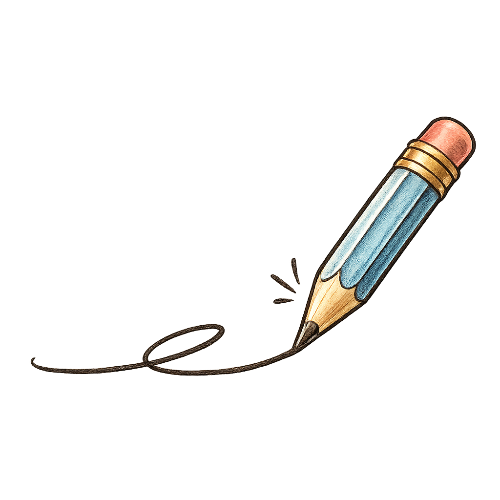 Beyond the Code

I've put together an interactive portfolio where you can flip through my projects, experiences, and the ideas I've brought to life.

<table>
  <tr>
    <td width="160" align="center" valign="middle">
      
    </td>
    <td width="240" valign="middle">
      <strong>Explore My Portfolio</strong>
        
      <a href="https://paperfolio-7c92.vercel.app/">
        Open portfolio ↗
      </a>
    </td>
  </tr>
</table>

---

### 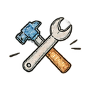 What I Work With

**AI & Machine Learning**

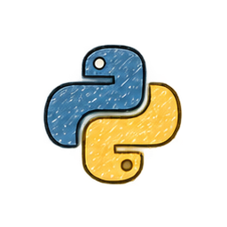 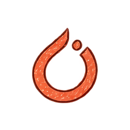  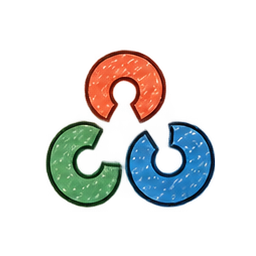

**Software & Frontend**

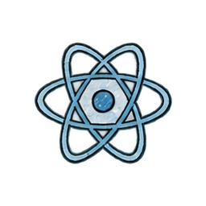 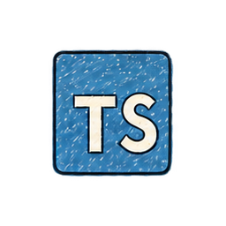 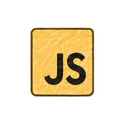  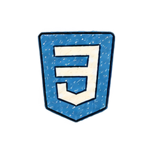 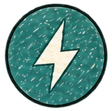

**Cloud & Developer Tools**

 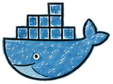 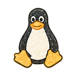 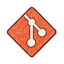 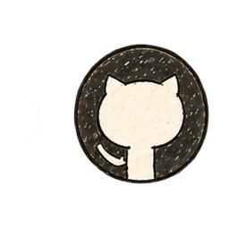

---

*Always learning. Always building.*
